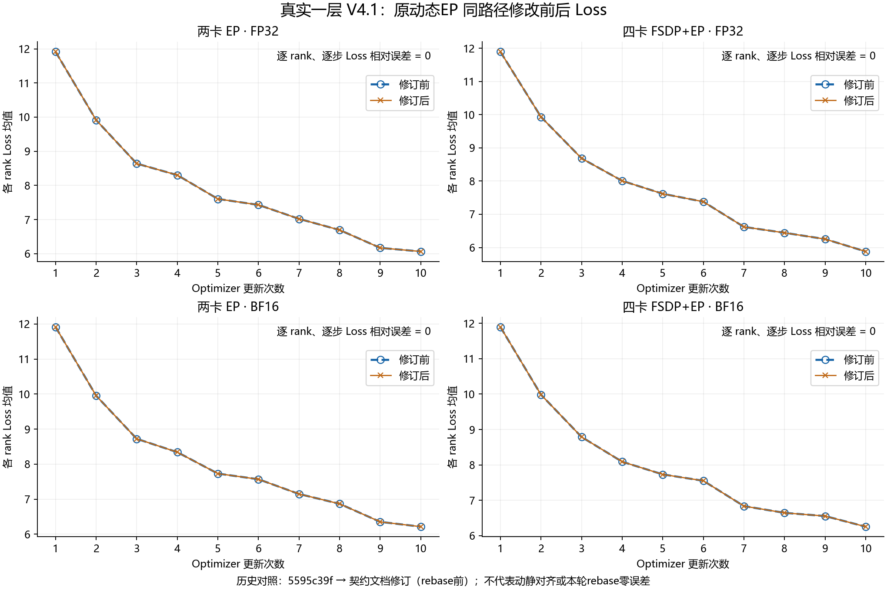
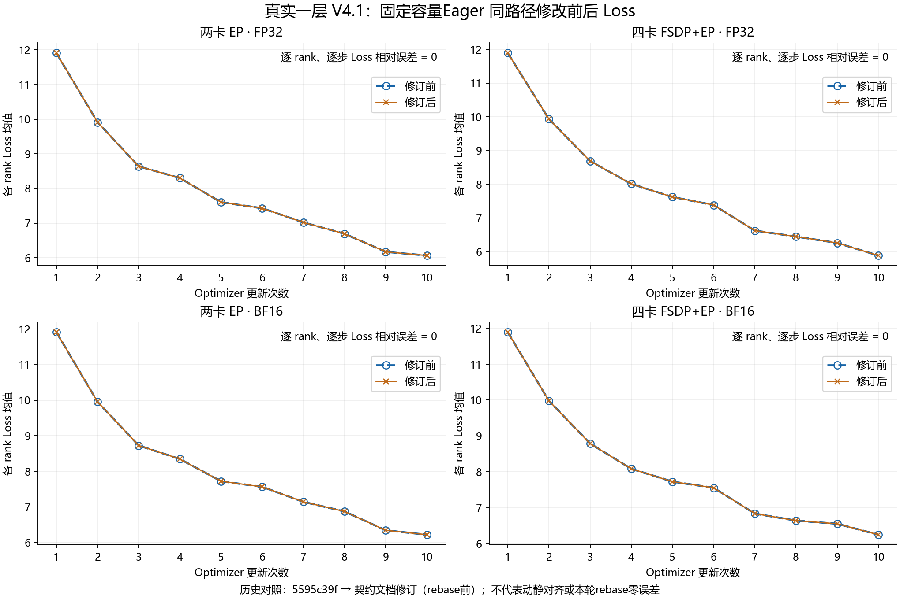
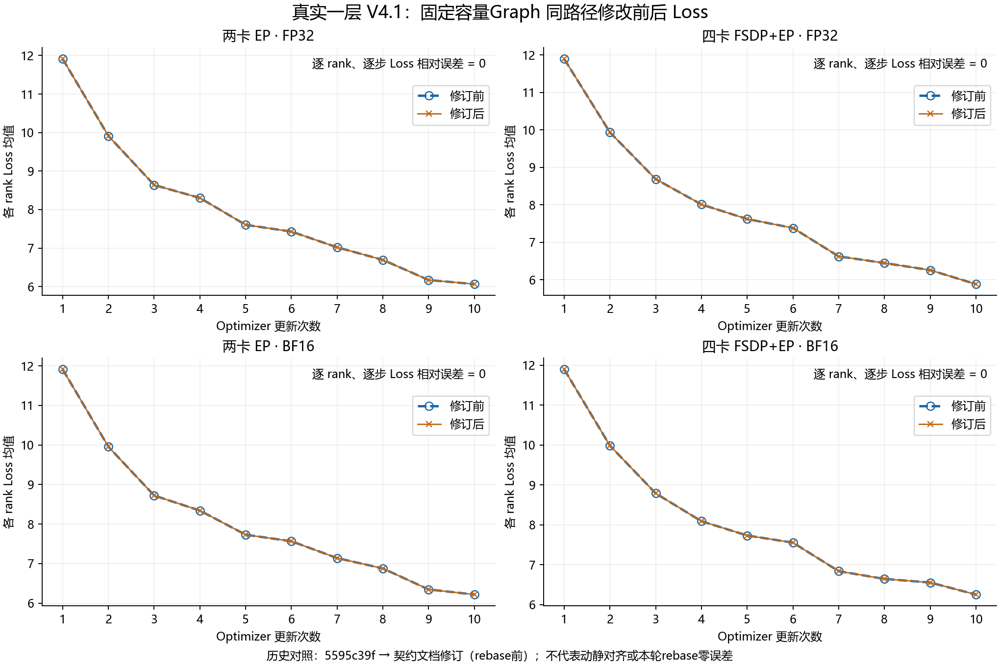

# PR1221: historical same-path loss comparison

These plots use the original 112 / torch + torch_npu 2.9.1 measurements:
one complete V4.1 decoder, EP2 and FSDP4+EP2, FP32/BF16, ten updates.
Each image compares only one execution path before/after the docstring-only
revision from 5595c39f (candidate source tree equals e3b5143c).
Every rank and step has exactly equal losses; displayed values are rank means.
The curves predate the current upstream rebase. They do not establish zero
error for the full feature versus upstream, for the current rebase, or between
graph and eager execution. Graph precision remains under development.

